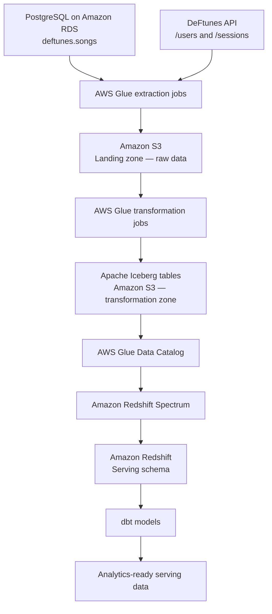

# DeFtunes — End-to-End Data Engineering Capstone

**Project focus:** ETL pipeline, AWS data lake, Apache Iceberg, Redshift Spectrum, infrastructure as code, and dbt  
**Project context:** DeFtunes music-streaming and digital song-purchase business  
**Region used in the lab configuration:** `us-east-1`

---

## 1. Project Overview

DeFtunes is a music platform that offers subscription-based song streaming and has expanded into digital song purchases. The business needs a reliable way to bring together operational song information and purchase activity so that its Data Analysis team can query consistent, well-structured data.

This project implements the first stage of that data platform. It extracts data from two types of sources, stores the raw data in an Amazon S3 data lake, transforms it into Apache Iceberg tables, and exposes the transformed datasets to Amazon Redshift. Terraform is used to provision the AWS infrastructure, while dbt provides the SQL modeling workflow for the serving layer.

The pipeline follows a three-zone, medallion-style design:

1. **Landing zone:** raw data extracted from the source systems and stored in Amazon S3.
2. **Transformation zone:** cleaned and structured data stored as Apache Iceberg tables in Amazon S3 and registered in the AWS Glue Data Catalog.
3. **Serving zone:** analytical access through Amazon Redshift and Redshift Spectrum, with dbt used to organize SQL transformations for the final serving layer.

The goal is to establish a repeatable foundation that can be extended with orchestration, data quality checks, and reporting.

## 2. Business Problem

The DeFtunes application has information in separate operational systems:

- A PostgreSQL database contains the catalogue of songs available for purchase.
- An API exposes user and session information associated with activity in the application.

Keeping these sources separate makes it harder for analysts to work with a unified view of the business. The data therefore needs to be extracted, stored centrally, standardized, and made available for analytical queries.

This capstone addresses that need by creating a data pipeline that:

- Extracts song data from PostgreSQL.
- Extracts users and sessions data from the API.
- Preserves source data in an S3 landing area.
- Normalizes and standardizes the extracted records.
- Stores transformed datasets in Apache Iceberg format.
- Uses the Glue Data Catalog to expose table metadata.
- Makes the transformed data queryable from Redshift Spectrum.
- Establishes a dbt project connected to the Redshift serving schema.

## 3. Project Objectives

The main technical objectives are:

- Build a three-zone data lake architecture using Amazon S3.
- Implement extraction and transformation workloads with AWS Glue.
- Store transformed datasets as Apache Iceberg tables.
- Use AWS Glue Data Catalog to maintain metadata for the Iceberg datasets.
- Provision reusable AWS infrastructure through Terraform modules.
- Use Amazon Redshift Spectrum to query the S3-based Iceberg tables without first copying all their data into native Redshift tables.
- Prepare a dbt project to manage SQL-based transformations in the serving layer.
- Keep credentials and generated environment files out of the public source repository.

## 4. Architecture

The architecture diagram below is included in the repository.


### 4.1 High-level data flow



### 4.2 Architecture components

| Component | Responsibility in this project |
|---|---|
| Amazon RDS for PostgreSQL | Hosts the operational `deftunes` database and its `songs` table. |
| DeFtunes API | Provides user and session records through API endpoints. |
| AWS Glue | Runs the extraction and transformation jobs. |
| Amazon S3 | Stores the landing-zone data and the transformed Iceberg datasets. |
| Apache Iceberg | Provides the table format used for the transformation-zone datasets. |
| AWS Glue Data Catalog | Stores metadata used to discover and query the Iceberg tables. |
| Amazon Redshift | Provides the data warehouse and serving environment. |
| Redshift Spectrum | Allows Redshift to query the S3 data through the Glue Catalog. |
| Terraform | Defines and provisions the AWS infrastructure in a repeatable way. |
| dbt | Provides the project structure and SQL workflow for serving-layer data models. |
| Python and SQL | Implement extraction, transformation, exploration, and analytical modeling tasks. |

## 5. Data Sources

The notebook documents two source systems.

### 5.1 PostgreSQL source database

The operational database runs on Amazon RDS with PostgreSQL.

- **Database:** `postgres`
- **Schema:** `deftunes`
- **Table used:** `songs`
- **Purpose:** provides the song catalogue and song-level information relevant to digital purchases.
- **Dataset context:** the notebook notes that the `songs` table is based on the Million Song Dataset.

The notebook connects to the database with SQL magic and explores the `deftunes.songs` table. A small sample is loaded into a Pandas DataFrame to inspect its columns, data types, and descriptive statistics.

### 5.2 DeFtunes API

The API provides application activity data.

| Endpoint | Information retrieved | Extraction purpose |
|---|---|---|
| `GET /sessions` | Session records, with a start-date and end-date filter | Extracts user session activity. |
| `GET /users` | User records | Extracts information about application users. |

The notebook tests the API requests and checks for a successful HTTP response. It also inspects example JSON records before the extraction jobs are deployed.

**Important:** the API host and AWS resource endpoints are environment-specific. Obtain current values from the CloudFormation stack outputs or the configured lab environment instead of copying endpoint values from an old notebook run.

## 6. Exploratory Data Analysis

Before building the pipeline, the notebook performs an initial exploration of the source data.

The steps include:

1. Querying a sample from `deftunes.songs` using SQL.
2. Converting the query result into a Pandas DataFrame.
3. Using `DataFrame.info()` to inspect column names, data types, and non-null values.
4. Using `DataFrame.describe()` to review summary statistics for numerical columns.
5. Converting the API JSON responses into DataFrames with `pandas.json_normalize()`.
6. Inspecting sample user and session records.

This exploration helps establish the structure of the source data before extraction and transformation logic is applied.

## 7. ETL Pipeline

The ETL workflow has three main phases: extraction into the landing zone, transformation into the Iceberg-based transformation zone, and analytical access through the serving zone.

### 7.1 Phase 1 — Landing zone: data extraction

The landing zone is the first layer of the S3 data lake. It stores data extracted from the source systems before the transformation jobs process it.

Three AWS Glue extraction jobs are provisioned:

| Glue job | Source | Purpose |
|---|---|---|
| `de-c4w4a1-rds-extract-job` | PostgreSQL on Amazon RDS | Extracts the `songs` data from the source database. |
| `de-c4w4a1-api-users-extract-job` | DeFtunes API `/users` endpoint | Extracts user records from the API. |
| `de-c4w4a1-api-sessions-extract-job` | DeFtunes API `/sessions` endpoint | Extracts session records from the API. |

The API extraction script accepts endpoint parameters and is reused for the API extraction workloads. The database extraction script handles the PostgreSQL source.

The notebook specifies that landing-zone data is organized into subfolders based on the ingestion date. In the lab, the default date is based on the server's Pacific Time setting (UTC−7).

**Output of this phase:** raw source extracts stored in the S3 landing zone, ready for transformation.

### 7.2 Phase 2 — Transformation zone: standardization and Iceberg

The transformation zone is the second layer of the data lake. Its purpose is to convert raw source extracts into structured datasets that can be queried consistently.

Two AWS Glue transformation jobs are provisioned:

| Glue job | Input | Transformation purpose |
|---|---|---|
| `de-c4w4a1-json-transform-job` | JSON data extracted from the API | Normalizes nested JSON fields, adds metadata, and writes the transformed data in Apache Iceberg format. |
| `de-c4w4a1-songs-transform-job` | Song data extracted from PostgreSQL | Casts fields to the appropriate data types, adds metadata, and writes the transformed data in Apache Iceberg format. |

The transformed datasets are stored in the S3 transformation zone as Apache Iceberg tables. Their table metadata is registered in the AWS Glue Data Catalog.

The notebook describes this layer as the **silver layer**.

**Why Apache Iceberg is used here:** it provides a table format for organizing the transformed datasets in the data lake. The Glue Catalog keeps the table metadata available to services such as Redshift Spectrum.

**Output of this phase:** structured Iceberg datasets for songs, users, and sessions, registered in the Glue Data Catalog.

### 7.3 Phase 3 — Serving zone: Redshift and Spectrum

The serving zone is the final layer of the architecture. It provides an analytical access layer for the transformed data.

Amazon Redshift is provisioned as the data warehouse. Redshift Spectrum is configured to access the Iceberg tables in S3 through the AWS Glue Data Catalog.

This is important because Spectrum can query the S3-based data through the external schema rather than requiring the project to load every source dataset into a native Redshift table first.

The notebook uses the following Redshift database and schema names:

| Name | Purpose |
|---|---|
| `dev` | Redshift database used in the lab. |
| `deftunes_transform` | External schema that exposes the transformation-zone Iceberg tables. |
| `deftunes_serving` | Schema intended for the serving-layer models. |

The notebook validates the setup by listing schemas and tables and selecting sample records from the external `songs`, `sessions`, and `users` tables.

The notebook describes the serving layer as the **gold layer**.

**Output of this phase:** an analytical environment in Redshift that can query the transformed Iceberg datasets and host serving-layer models.

## 8. Infrastructure as Code with Terraform

Terraform is used to define and provision the AWS infrastructure. The project separates infrastructure into modules so that the extraction, transformation, and serving components can be deployed in stages.

### 8.1 Terraform module layout

| Module | Main responsibility | Supporting configuration |
|---|---|---|
| `extract_job` | Creates the extraction Glue jobs and supporting access/network configuration. | Glue job definitions, IAM role and policies, private subnet and database security-group configuration, variables, and outputs. |
| `transform_job` | Creates the Glue transformation jobs and associated configuration for writing transformed datasets. | Glue job definitions, variables, and outputs. |
| `serving` | Creates the Redshift serving infrastructure and its required IAM configuration. | Redshift resource definition, IAM configuration, provider configuration, variables, and outputs. |

The root Terraform configuration is in the `terraform/` directory. The module definitions are connected through `main.tf`, and relevant deployment outputs are exposed through `outputs.tf`.

### 8.2 Deployment sequence

Run Terraform from the `terraform` directory. The notebook deploys the modules in this order:

```bash
cd terraform
terraform init
terraform plan
```

Deploy the extraction module:

```bash
terraform apply -target=module.extract_job
```

Deploy the transformation module:

```bash
terraform apply -target=module.transform_job
```

Deploy the serving module:

```bash
terraform apply -target=module.serving
```

Terraform prompts for confirmation before applying infrastructure changes. Review the plan and confirm that the target resources and region are correct before approving an apply.

**Note:** targeted applies are the staged deployment approach shown in the capstone notebook. For a production workflow, review the complete Terraform dependency graph and deployment plan rather than assuming targeted applies are always the preferred approach.

### 8.3 Glue script storage

The notebook copies the Python Glue scripts to the S3 scripts bucket before deploying and running the related jobs. The scripts are stored in:

- `terraform/assets/extract_jobs/`
- `terraform/assets/transform_jobs/`

The scripts bucket name is supplied by the lab environment. Use the current CloudFormation output or environment configuration to identify it.

### 8.4 Running and monitoring Glue jobs

The notebook starts a Glue job with the AWS CLI:

```bash
aws glue start-job-run --job-name <JOB-NAME>
```

The returned job run ID can be used to check the job state:

```bash
aws glue get-job-run \
  --job-name <JOB-NAME> \
  --run-id <JOB-RUN-ID> \
  --query "JobRun.JobRunState" \
  --output text
```

A successful run reports:

```text
SUCCEEDED
```

Run the three extraction jobs after deploying the extraction module. Run the two transformation jobs after deploying the transformation module. The serving infrastructure is deployed after the transformation layer is in place.

## 9. Validating the Data in Redshift

After the serving infrastructure has been deployed, the notebook verifies that Redshift can discover and query the Iceberg tables through Spectrum.

Examples of the validation queries used in the notebook:

```sql
SHOW SCHEMAS FROM DATABASE dev;
```

List the tables exposed by the external schema:

```sql
SHOW TABLES FROM SCHEMA dev.deftunes_transform;
```

Inspect a sample of the songs:

```sql
SELECT *
FROM deftunes_transform.songs
LIMIT 10;
```

Inspect a sample of the sessions:

```sql
SELECT *
FROM deftunes_transform.sessions
LIMIT 10;
```

Inspect a sample of the users:

```sql
SELECT *
FROM deftunes_transform.users
LIMIT 10;
```

These checks validate that the external schema is available and that Redshift Spectrum can read the registered transformation-zone tables.

## 10. Data Modeling with dbt

The project includes a dbt project under `dbt_modeling/`. The notebook uses dbt with Amazon Redshift as the target so SQL models can be organized and executed in the serving environment.

### 10.1 dbt connection configuration

The lab's Redshift connection uses the following settings:

| Setting | Value or source |
|---|---|
| Adapter | Redshift |
| Host | Current Redshift cluster endpoint from the AWS environment |
| Port | `5439` |
| Database | `dev` |
| User | Configured Redshift user |
| Schema | `deftunes_serving` |
| Threads | `1` |

Use the template at `scripts/profiles.yml.example` as a reference. Replace its placeholders with the current environment's connection details in a local dbt profile. Do not commit a profile containing real credentials.

A typical local profile location is:

```text
~/.dbt/profiles.yml
```

Test the connection from the dbt project directory:

```bash
cd dbt_modeling
dbt debug
```

A successful connection test reports an `OK` connection status.

### 10.2 Serving-layer modeling

The notebook describes an optional modeling extension in which a `serving_layer` folder is created under `dbt_modeling/models/`. The intention is to organize the final analytical models around a star schema:

- **Fact tables** represent measurable business events or activity.
- **Dimension tables** provide descriptive context for analyzing those events.
- dbt SQL model files define the transformations.
- A `schema.yml` file can document models and define tests.

When the `serving_layer` models have been created, the notebook shows this command to build them:

```bash
dbt run -s serving_layer
```

The resulting tables can then be checked in Redshift:

```sql
SHOW TABLES FROM SCHEMA dev.deftunes_serving;
```

Query an individual serving model:

```sql
SELECT *
FROM deftunes_serving.<TABLE_NAME>
LIMIT 10;
```

**Repository note:** the committed dbt files should be treated as the source of truth for which models are actually implemented. The notebook describes the star-schema exercise as optional; do not assume a particular set of fact or dimension tables unless the corresponding SQL model files are present in this repository.

## 11. Repository Structure

The repository is organized so that the notebook, infrastructure code, Glue scripts, dbt project, and architecture images can be reviewed separately.

```text
.
├── README.md
├── .gitignore
├── C4_W4_Assignment_1.ipynb
│
├── images/
│   ├── Capstone-diagram.png
│   ├── dbt_config.png
│   ├── AWSLogout.png
│   ├── reboot.png
│   └── terminal_crash.png
│
├── scripts/
│   ├── setup.sh
│   └── profiles.yml.example
│
├── terraform/
│   ├── assets/
│   │   ├── extract_jobs/
│   │   │   ├── de-c4w4a1-api-extract-job.py
│   │   │   └── de-c4w4a1-extract-songs-job.py
│   │   └── transform_jobs/
│   │       ├── de-c4w4a1-transform-json-job.py
│   │       └── de-c4w4a1-transform-songs-job.py
│   │
│   ├── modules/
│   │   ├── extract_job/
│   │   ├── transform_job/
│   │   └── serving/
│   │
│   ├── backend.tf
│   ├── main.tf
│   ├── outputs.tf
│   ├── providers.tf
│   ├── variables.tf
│   └── .terraform.lock.hcl
│
└── dbt_modeling/
    ├── analyses/
    ├── macros/
    ├── models/
    │   └── example/
    │       ├── my_first_dbt_model.sql
    │       ├── my_second_dbt_model.sql
    │       └── schema.yml
    ├── seeds/
    ├── snapshots/
    ├── tests/
    ├── dbt_project.yml
    └── README.md
```

Generated directories such as Terraform's `.terraform/`, Terraform state files, dbt `target/` and `logs/`, and local credential files are intentionally excluded from version control.

## 12. Running the Project — Practical Checklist

Use the following sequence as a high-level checklist. Exact endpoint values, resource identifiers, and credentials must come from the current AWS lab environment.

1. **Prepare the environment**
   - Configure AWS CLI credentials.
   - Confirm access to the lab's AWS account and region.
   - Review `scripts/setup.sh` and the Terraform variables.
   - Run the setup script from the project root when the required AWS resources are available:

   ```bash
   source scripts/setup.sh
   ```

2. **Prepare the extraction jobs**
   - Review the Python scripts under `terraform/assets/extract_jobs/`.
   - Upload the extraction scripts to the S3 scripts bucket.
   - Initialize Terraform and deploy `module.extract_job`.

3. **Extract the source data**
   - Start the RDS songs extraction job.
   - Start the API users extraction job.
   - Start the API sessions extraction job.
   - Monitor the job runs until they finish successfully.

4. **Prepare and run transformations**
   - Review the scripts under `terraform/assets/transform_jobs/`.
   - Upload the transformation scripts to the S3 scripts bucket.
   - Deploy `module.transform_job`.
   - Start the JSON transformation job and the songs transformation job.
   - Verify that the transformed Iceberg tables are registered in the Glue Catalog.

5. **Deploy the serving layer**
   - Deploy `module.serving`.
   - Confirm the Redshift cluster and the required IAM configuration.
   - Verify the external schema and query the Iceberg tables with Redshift Spectrum.

6. **Configure and test dbt**
   - Configure a local `~/.dbt/profiles.yml` using the safe example profile.
   - Run `dbt debug` to test connectivity.
   - Run the dbt models that are present in the project.
   - Query the resulting serving tables in Redshift.

## 13. Security and Configuration

This repository is intended to be a reviewable project portfolio, not a place to publish live infrastructure credentials.

- Do not commit AWS access keys, session tokens, console sign-in URLs, database passwords, private keys, or real `.env` files.
- Keep `scripts/profiles.yml` local; use `scripts/profiles.yml.example` as the shareable template.
- Supply database credentials through the local environment or interactive prompts.
- Use current endpoints from the AWS environment rather than embedding temporary endpoint values in source code.
- Review Terraform variables and backend configuration before deploying from a different AWS account.
- The `.gitignore` file excludes local credentials and generated Terraform/dbt files.

The notebook may need fresh resource endpoints and configuration values when the lab environment is recreated. Old outputs should not be treated as reusable credentials or current infrastructure identifiers.

## 14. Scope and Possible Extensions

The uploaded capstone notebook identifies this work as **Part 1 — ETL and Data Modeling**. It establishes the data architecture, extraction and transformation pipeline, serving infrastructure, and dbt workflow.

The notebook describes a subsequent part of the capstone as an opportunity to improve the initial architecture with:

- Pipeline orchestration.
- Data visualization.
- Data quality checks.

These are natural extensions of the foundation built here. They should only be described as implemented when their corresponding code and configuration are included in the repository.

## 15. Skills Demonstrated

This project brings together several practical data engineering skills:

- Working with PostgreSQL and REST API data sources.
- Exploring structured and JSON data with SQL and Pandas.
- Building extraction and transformation workloads with AWS Glue.
- Designing a landing, transformation, and serving-zone data lake.
- Storing analytical datasets in Amazon S3 using Apache Iceberg.
- Managing table metadata through AWS Glue Data Catalog.
- Querying data lake tables with Amazon Redshift Spectrum.
- Provisioning modular cloud infrastructure with Terraform.
- Organizing SQL transformations in a dbt project.
- Validating pipeline stages and database connectivity.
- Managing configuration and excluding credentials from source control.

## 16. Acknowledgment

This repository documents the DeFtunes ETL and data modeling capstone completed as part of a Coursera data engineering learning program. The accompanying notebook contains the lab walkthrough and the project-specific implementation sequence.

---

**Project takeaway:** DeFtunes demonstrates how operational database records and API data can be brought into an S3-based data lake, transformed into catalogued Iceberg tables, and made available for analytics through Redshift Spectrum and a dbt-oriented serving workflow.
