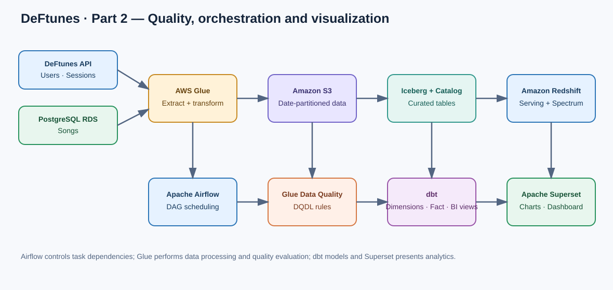

# DeFtunes Capstone — Part 2

Part 2 extends the DeFtunes AWS data platform with **data quality checks, Apache Airflow orchestration, incremental ingestion, dbt analytical models, and an Apache Superset visualization layer**.

This folder is self-contained and sits alongside the Part 1 project in the parent repository.

## 1. What changed in Part 2?

DeFtunes expanded from streaming into digital song purchases. The analytical team needs a repeatable pipeline that ingests new API and operational database records, checks their quality, models the data for analysis, and exposes business-facing views.

Part 2 adds five capabilities:

1. **Incremental ingestion** — each pipeline run passes a logical ingestion date to Glue and writes the batch under a date-partitioned S3 path.
2. **Data quality** — AWS Glue Data Quality evaluates rule sets against curated Glue Catalog tables.
3. **Orchestration** — Apache Airflow coordinates extraction, transformation, data-quality evaluation, and dbt execution.
4. **Analytical modeling** — dbt builds a serving-layer star schema and business views for sales analysis.
5. **Visualization** — Apache Superset connects to Amazon Redshift and uses business views as chart datasets and dashboard inputs.

## 2. Part 2 architecture

The main processing path is:

**DeFtunes API (users and sessions) + PostgreSQL RDS (songs)**  
→ **Apache Airflow orchestration**  
→ **AWS Glue extraction jobs**  
→ **Amazon S3 landing zone**  
→ **AWS Glue transformations using Spark**  
→ **Apache Iceberg tables in the S3 transformation zone**  
→ **AWS Glue Data Catalog and Data Quality**  
→ **Amazon Redshift Spectrum**  
→ **dbt star-schema models and BI views**  
→ **Amazon Redshift serving layer**  
→ **Apache Superset dashboards**

### Data zones

| Zone | Purpose | Main technology |
|---|---|---|
| Landing | Stores raw API JSON and RDS song extracts by ingestion date | Amazon S3 |
| Transformation | Stores cleansed, typed and enriched data in Iceberg tables | AWS Glue, Apache Spark, Apache Iceberg |
| Catalog | Maintains table metadata and makes Iceberg datasets discoverable | AWS Glue Data Catalog |
| Serving | Holds analytical star-schema tables and business views | Amazon Redshift, dbt |
| Visualization | Connects business views to charts and dashboards | Apache Superset |

## 3. Incremental ingestion

The extract jobs receive an ingest_date argument. The date becomes a partition key in the S3 landing zone:

- API users: landing_zone/api/users/ingest_on=YYYY_MM_DD/
- API sessions: landing_zone/api/sessions/ingest_on=YYYY_MM_DD/
- RDS songs: landing_zone/db_songs/ingest_on=YYYY_MM_DD/

The transformation jobs read the corresponding date partition and add ingestion metadata to curated records. The Iceberg tables are partitioned by ingest_on; when a target table exists, the job appends the incoming batch, otherwise it creates the table.

The date passed by Airflow is based on the DAG data interval. The sample Terraform job defaults use an initial historical date (2020-02-01) to support the lab's initial backfill. Update the initial API range and ingestion date when adapting this example to another data period.

## 4. Data quality with AWS Glue

The Terraform module at part2/terraform/modules/data_quality creates three Glue Data Quality rule sets against the curated tables in the Glue Data Catalog.

| Dataset | Rules included in the supplied DQDL | What they check |
|---|---|---|
| Songs | IsComplete track_id; ColumnLength track_id = 18; IsComplete song_id; ColumnLength song_id = 18; IsComplete artist_id | Required identifiers, expected identifier lengths, and artist ID presence |
| Sessions | IsComplete user_id; IsComplete session_id; both ID lengths equal 36; IsComplete song_id; price <= 2 | Required session/user/song identifiers, identifier shape, and a business price bound |
| Users | IsComplete user_id; Uniqueness user_id > 0.95; IsComplete user_lastname; IsComplete user_name; IsComplete user_since | Required user attributes and a uniqueness threshold for user IDs |

The rule sets are evaluated by Airflow using GlueDataQualityRuleSetEvaluationRunOperator. The operator waits for evaluation to complete before the downstream dbt task can run.

A quality rule is an explicit expectation about the data. Completeness rules catch missing values, uniqueness evaluates identifier duplication, length rules check identifier shape, and the price rule enforces a domain-specific bound. These are lab examples; review thresholds against the actual business definition before production use.

## 5. Orchestration with Apache Airflow

Two DAGs coordinate the pipelines. Both include retries and a five-minute retry delay, and use catchup=True to support historical backfilling across their configured date windows.

### 5.1 Songs pipeline

File: part2/dags/deftunes_songs_pipeline.py

**start → RDS songs extraction (Glue) → songs transformation to Iceberg (Glue) → songs data-quality evaluation (Glue Data Quality) → dbt debug and dbt run (DockerOperator) → end**

### 5.2 API pipeline

File: part2/dags/deftunes_api_pipeline.py

The users and sessions API extraction tasks run in parallel. The JSON transformation starts after both finish. The users and sessions quality checks then run in parallel. dbt runs after both quality checks have completed.

**start → [users API extract + sessions API extract] → JSON transformation → [users quality + sessions quality] → dbt → end**

### 5.3 Airflow configuration

The DAGs use Airflow Variables for environment-specific configuration rather than embedding account-specific bucket names, hostnames or IAM role ARNs in source code.

| Airflow Variable | Purpose |
|---|---|
| deftunes_project | Resource-name prefix, for example de-c4w4a2 |
| aws_region | AWS region |
| deftunes_data_lake_bucket | S3 landing and transformation bucket |
| deftunes_scripts_bucket | S3 bucket containing Glue scripts |
| deftunes_api_base_url | DeFtunes API base URL (scheme and host only) |
| deftunes_catalog_database | Glue Catalog database name |
| deftunes_glue_role_arn | Full Glue execution-role ARN |
| deftunes_dbt_project_host_path | Host path mounted into the dbt Docker container |
| deftunes_dbt_network_mode | Docker network mode for the dbt container |
| deftunes_dbt_image | dbt Docker image |
| deftunes_schedule | Airflow cron schedule |

**Scheduling note:** The original lab DAG sample uses 0 0 1 * * (midnight on the first day of each month), while the assignment's written requirement describes a daily pipeline. The supplied DAGs preserve the lab sample as the default but allow the schedule to be overridden with deftunes_schedule (for example, @daily) after validating the desired backfill volume and API/date semantics.

The original lab environment provides a restart script at part2/scripts/restart_airflow.sh. The repository version discovers the running instance through AWS tags and polls the Systems Manager command until completion or failure.

## 6. dbt analytical modeling

The dbt project is under part2/dbt_modeling. It separates serving-layer dimensional models from BI views.

### 6.1 Serving star schema

| Model | Type | Source | Purpose |
|---|---|---|---|
| dim_users | Dimension | deftunes_transform.users | User attributes including name, signup date, place and country |
| dim_songs | Dimension | deftunes_transform.songs | Song, track, release and year attributes |
| dim_artists | Dimension | deftunes_transform.songs | Distinct artist identifiers and names |
| fact_session | Fact | deftunes_transform.sessions | Session-level user, song, artist, price, like and time measures |

The serving models are materialized as tables in deftunes_serving. The schema tests define uniqueness and non-null expectations for key identifiers.

### 6.2 Business views

| View | Grain | Main calculation |
|---|---|---|
| sales_per_artist_vw | Year and artist | Sum of session prices by artist and year |
| sales_per_country_vw | Year, month and country | Sum of session prices by user country and calendar month |

The BI views are configured as dbt views in the bi_views model folder. With the project's schema naming convention, dbt creates the BI schema shown in the lab as deftunes_bi_views.

The dbt project includes schema YAML files describing the models and tests. The package declaration in part2/scripts/packages.yml includes calogica/dbt_date.

## 7. Visualization with Apache Superset

The lab environment provides an Apache Superset instance. The documented workflow is:

1. Open the Superset endpoint provided by the AWS environment's CloudFormation outputs.
2. Configure an Amazon Redshift database connection using the environment's Redshift SQLAlchemy connection URI.
3. Test the connection.
4. Add datasets from the BI views schema (the lab describes deftunes_bi_views).
5. Create a chart for each view: sales by artist/year and sales by country/month/year.
6. Create a dashboard and add, arrange, resize and save the charts.

The uploaded lab archive contains Superset UI screenshots but no exported dashboard definition. This repository documents the dashboard workflow; it does not claim to include a portable Superset dashboard export.

## 8. Repository layout

- dags/ — two Airflow DAGs for the API and songs pipelines.
- dbt_modeling/ — dbt project, four serving-layer models, two BI views, and YAML tests.
- scripts/ — dbt packages, a credential-free profile template, environment setup, and Airflow restart helper.
- terraform/assets/ — two extraction and two transformation Glue scripts.
- terraform/modules/data_quality/ — Glue Data Quality rule sets.
- terraform/modules/extract_job/ — RDS connection, IAM role, and extraction Glue jobs.
- terraform/modules/transform_job/ — Glue Catalog database and Iceberg transformation jobs.
- terraform/modules/serving/ — Redshift serving and external schemas.
- terraform/ — root Terraform configuration, outputs, provider setup, and variable examples.

The Coursera assignment notebook is intentionally not included, per the project owner's preference. The archive's OS-specific .DS_Store files and local profiles.yml containing credentials are also excluded.

## 9. Setup overview

This is a training-lab implementation and requires an AWS account with the required services, permissions, and pre-provisioned DeFtunes source environment.

### Prerequisites

- AWS CLI configured with credentials for the target lab account.
- Terraform installed.
- Access to the DeFtunes PostgreSQL RDS instance and API.
- AWS Glue, S3, Glue Data Catalog, Redshift and IAM permissions.
- Apache Airflow with the Amazon and Docker providers installed.
- Docker daemon and the dbt image used by the Airflow environment.
- dbt Core and the Amazon Redshift adapter.
- Apache Superset with permission to create a Redshift connection, datasets, charts and dashboards.

### Configure locally

From the repository root:

1. Review part2/terraform/terraform.tfvars.example and create a local terraform.tfvars with the actual environment values. Do not commit the local file.
2. Source the setup script to discover the lab's AWS resources, prompt for database passwords, and upload the Glue scripts:

   source part2/scripts/setup.sh

3. Initialize and review Terraform:

   cd part2/terraform
   terraform init
   terraform validate
   terraform plan

4. Apply modules in dependency order, reviewing each plan before approving it:

   terraform apply -target=module.extract_job
   terraform apply -target=module.transform_job
   terraform apply -target=module.serving
   terraform apply -target=module.data_quality

5. Perform the initial extraction and transformation runs for the required historical date range, then verify the resulting Glue Catalog tables and Redshift Spectrum schemas.
6. Copy the dbt project and DAG files to the lab-provided S3 locations (for example, the DBTBucket and DagsBucket outputs) and configure the Airflow Variables listed above.
7. Verify the DAGs are loaded, unpause the intended DAGs, and inspect task logs and quality evaluation results.
8. Configure Superset's Redshift connection and create datasets, charts and a dashboard from the BI views.

Actual bucket names, network IDs, endpoints and role ARNs are environment-specific and must come from the target AWS environment. They are intentionally not stored in this repository.

## 10. Security and operational notes

- Do not commit profiles.yml, terraform.tfvars, Terraform state, access keys, passwords, tokens, or AWS console sign-in URLs.
- part2/scripts/setup.sh prompts for database passwords and keeps them in the current shell session; it does not append them to ~/.bashrc.
- part2/scripts/profiles.yml.example is a template. Create a private local dbt profile and replace all placeholders.
- Airflow Variables must be configured in the Airflow environment. The DAGs use placeholders by default so they can be parsed before configuration; do not unpause the DAGs while values are still placeholders.
- The IAM policy in the training module is intentionally broad to mirror a lab exercise. Replace wildcard permissions with least-privilege permissions before adapting it to production.
- The Terraform backend uses local state. Keep the state file private and back it up securely.
- AWS Glue, Redshift, S3, EC2, Airflow and Superset can incur charges. Review resources and destroy lab infrastructure when it is no longer needed, while preserving any data that must be retained.

## 11. What this demonstrates

Part 2 demonstrates how a data pipeline evolves from a set of extraction and transformation jobs into an operational workflow:

- Incremental, date-partitioned ingestion.
- Data quality expectations expressed as DQDL rules.
- Dependency management, retries and backfills through Airflow DAGs.
- Star-schema modeling and business aggregation through dbt.
- Serving curated analytical views to a BI platform through Redshift and Superset.

Together with Part 1, the repository presents the progression from cloud ETL foundations to a more governed, orchestrated and analytics-ready data platform.
